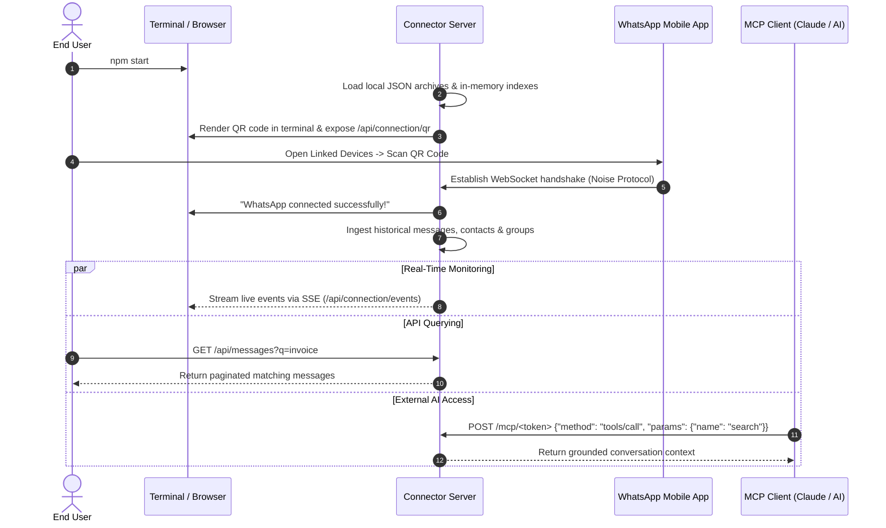
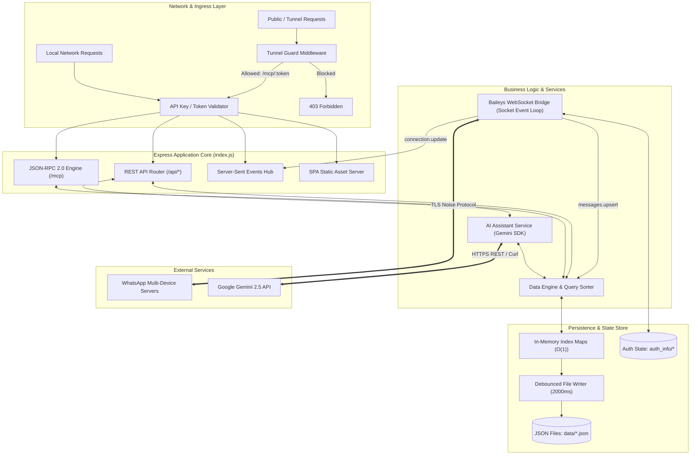
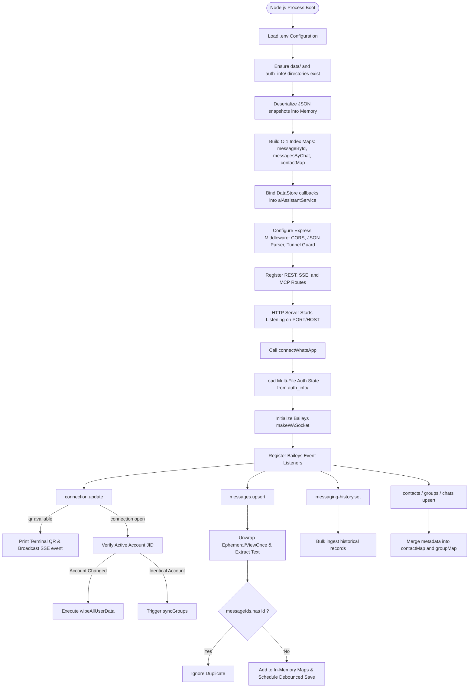
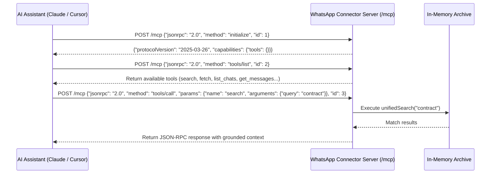
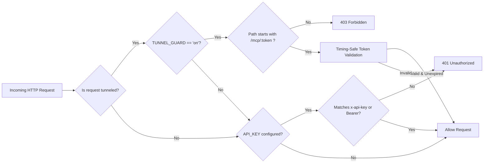

# 🚀 WhatsApp Connector Server

An enterprise-grade, privacy-first WhatsApp bridge, real-time archiver, and conversational intelligence engine powered by Baileys Multi-Device WebSockets, Express.js, Model Context Protocol (MCP), and Google Gemini AI.

[](https://nodejs.org/)
[](https://expressjs.com/)
[](https://github.com/WhiskeySockets/Baileys)
[](https://ai.google.dev/)
[](#section-11-mcp-integration)
[](https://github.com/imranpathan0603)
[](LICENSE)

---

## 📑 Table of Contents

- [SECTION 1: Project Introduction](#section-1-project-introduction)
- [SECTION 2: Problem Statement and Solution](#section-2-problem-statement-and-solution)
- [SECTION 3: Features and Functionalities](#section-3-features-and-functionalities)
- [SECTION 4: End User Perspective – Application Workflow](#section-4-end-user-perspective--application-workflow)
- [SECTION 5: End User Guide](#section-5-end-user-guide)
- [SECTION 6: Developer Perspective – System Architecture](#section-6-developer-perspective--system-architecture)
- [SECTION 7: Internal Application Workflow](#section-7-internal-application-workflow)
- [SECTION 8: Algorithms and Core Logic](#section-8-algorithms-and-core-logic)
- [SECTION 9: Technology Stack](#section-9-technology-stack)
- [SECTION 10: API Documentation](#section-10-api-documentation)
- [SECTION 11: MCP Integration](#section-11-mcp-integration)
- [SECTION 12: Database and Data Storage](#section-12-database-and-data-storage)
- [SECTION 13: Security Architecture](#section-13-security-architecture)
- [SECTION 14: Project Directory Structure](#section-14-project-directory-structure)
- [SECTION 15: Installation and Configuration](#section-15-installation-and-configuration)
- [SECTION 16: Error Handling and Troubleshooting](#section-16-error-handling-and-troubleshooting)
- [SECTION 17: Limitations and Future Enhancements](#section-17-limitations-and-future-enhancements)
- [SECTION 18: Testing and Validation](#section-18-testing-and-validation)
- [SECTION 19: Important Technical Considerations](#section-19-important-technical-considerations)
- [SECTION 20: Author and Project Information](#section-20-author-and-project-information)

---

## SECTION 1: Project Introduction

### 1.1 Project Overview
**WhatsApp Connector Server** is an autonomous backend service and connector bridge designed and developed by **Imran Pathan**. It establishes a direct, persistent Multi-Device WebSocket bridge to WhatsApp using the Baileys protocol engine. The server continuously captures, normalizes, indexes, and archives all incoming and outgoing messages, contacts, group channels, and media metadata. It exposes this data through a high-performance RESTful API, a real-time Server-Sent Events (SSE) telemetry bus, an authenticated **Model Context Protocol (MCP)** server for AI agent integrations (e.g., Claude, Cursor, Anthropic Desktop, LangChain), and a conversational AI Copilot service backed by Google Gemini.

### 1.2 Project Purpose
The purpose of WhatsApp Connector Server is to liberate personal and operational conversation data from closed mobile silos into an open, programmatically queryable, developer-friendly architecture without requiring expensive, permission-gated WhatsApp Business Cloud API licenses.

### 1.3 Problem Statement
Personal and organizational WhatsApp accounts contain high-value operational context: invoices, decisions, agreements, media, and customer support trails. However, querying this data programmatically presents steep barriers:
- No native public REST API exists for standard WhatsApp personal/business accounts.
- Desktop and mobile apps lock data into encrypted local SQLite databases that cannot be queried remotely.
- WhatsApp Business Cloud APIs require corporate verification, Meta approval, per-template fees, and do not capture personal peer-to-peer discussions.
- AI assistants and automation pipelines lack structured, real-time access to user chat histories.

### 1.4 Why This Project Was Developed
Imran Pathan engineered this application to provide a clean, self-hosted infrastructure layer that converts raw WhatsApp Noise Protocol WebSocket frames into searchable JSON documents, indexed memory tables, and an autonomous Model Context Protocol (MCP) server.

### 1.5 Main Objectives
1. **Zero-Configuration WhatsApp Bridge**: Connect via standard Multi-Device QR code pairing.
2. **Real-Time Data Mirroring**: Capture messages, contacts, and group events as they occur.
3. **High-Throughput In-Memory Indexing**: Provide $O(1)$ constant-time lookup by ID, chat JID, and sender.
4. **AI Agent Tooling**: Native JSON-RPC 2.0 MCP endpoint (`tools/list`, `tools/call`) for external LLMs.
5. **Zero Data Leakage**: Synchronous session purging and memory wiping upon account changes or sign-outs.

### 1.6 Key Features
- **Baileys Multi-Device Engine**: Direct WebSocket client supporting multi-file authentication state.
- **Protocol Message Unwrapper**: Resolves edits, revocations, and ephemeral message containers.
- **RESTful Endpoints**: Over 30 specialized endpoints for system, messages, chats, contacts, groups, analytics, and exports.
- **Server-Sent Events (SSE)**: Real-time broadcast channel (`/api/connection/events`) for live status and incoming messages.
- **AI Copilot & Executive Summaries**: Grounded summarization and analytics using Google Gemini.
- **Export Engine**: Paginated JSON and CSV data streaming with custom date and chat filters.
- **Security Guard**: Tunnel protection, timing-safe temporary tokens, and API key protection.

### 1.7 Project Scope
The project encompasses the complete backend synchronization layer, message normalization pipelines, in-memory index management, debounced JSON storage, MCP server tooling, and security guards. It also serves compiled single-page application (SPA) frontend assets when available.

### 1.8 Real-World Use Cases
- **Enterprise Executive Briefings**: Automated daily/weekly summaries of team discussions and group channels.
- **Customer Relationship Auditing**: Querying historical communication threads with clients.
- **Automated AI Support Agents**: Connecting Claude Desktop or custom agents via MCP to answer questions based on real chat history.
- **Data Compliance & Archival**: Maintaining exportable, off-device JSON/CSV records of operational discussions.

### 1.9 Target Users
- Software Engineers and DevOps professionals building conversational automation.
- Small-to-medium businesses requiring searchable audit trails of WhatsApp discussions.
- AI Engineers seeking grounded RAG contexts from real-time messaging data.

---

## SECTION 2: Problem Statement and Solution

| Challenge | WhatsApp Native Limitation | WhatsApp Connector Server Solution |
| :--- | :--- | :--- |
| **Data Access** | Locked inside mobile device sandboxes and encrypted SQLite stores. | Decodes WebSocket Noise protocol into standardized JSON records. |
| **Queryability** | Primitive string search; no multi-field filtering or cross-chat joins. | Advanced query engine: filter by sender, direction, date range, media kind, and keywords. |
| **AI Tooling** | LLMs cannot access active WhatsApp threads natively. | Native Model Context Protocol (MCP) tool server running JSON-RPC 2.0 over HTTP. |
| **Real-Time Events** | Webhook notifications require Meta Business Cloud API setup. | Built-in Server-Sent Events (SSE) bus streaming message and connection events. |
| **Media & Link Audits**| Media and URLs are buried across scattered chat bubbles. | Aggregated media vaults and automated regex URL extractors with domain filtering. |
| **Session Isolation** | Multi-account switching leaves orphaned cache fragments. | Atomic multi-tenant data sanitizer wiping memory, disk snapshots, and AI sessions on logout. |

---

## SECTION 3: Features and Functionalities

- **WhatsApp Account Connection**: Initializes a non-blocking WebSocket handshake with WhatsApp Web infrastructure using `@whiskeysockets/baileys`.
- **QR Code Authentication**: Generates terminal ASCII QR codes (`qrcode-terminal`) and base64 data URL images (`qrcode`) for web-based scanning.
- **Message Synchronization**: Captures incoming and outgoing messages via `messages.upsert` and historical sync via `messaging-history.set`.
- **Chat History Archiving**: Writes normalized messages to disk storage using asynchronous debounced flush operations.
- **Contact Synchronization**: Ingests individual contact cards, push names, phone numbers, and verified business names into memory maps.
- **Group Synchronization**: Fetches comprehensive group metadata (`groupFetchAllParticipating`), subjects, descriptions, creation dates, and participant rosters.
- **Individual and Group Chat Identification**: Classifies chats dynamically based on JID suffix patterns (`@g.us`, `@s.whatsapp.net`, `@newsletter`, `@broadcast`).
- **Message Search**: Multi-word tokenized substring search over message text bodies.
- **Unified Search**: Single query search across all entities (Messages, Chats, Contacts, Groups) with relevance weighting.
- **Message Filtering**: Multi-parameter query engine filtering by `chatId`, `sender`, `fromMe`, `isGroup`, `type`, `kind`, `hasText`, `from`, `to`, `q`, and `order`.
- **Message Context Retrieval**: Fetches a target message along with configurable `before` and `after` sibling messages to preserve conversation flow.
- **Reply and Quoted-Message Lookup**: Resolves quoted message references (`stanzaId`) to assemble bidirectional reply threads.
- **Media Message Identification**: Normalizes images, videos, audio notes, documents, and stickers with mime types and file sizes.
- **URL Extraction from Messages**: Regex parsing engine extracting web hyperlinks and indexing them with domain metadata.
- **Chat Transcripts**: Generates timestamped plain-text conversation transcripts formatted for LLM prompt ingestion.
- **Message Analytics**: Calculates total messages, directional split (sent vs. received), media distributions, and temporal spans.
- **Daily and Hourly Statistics**: Aggregates conversation volume into 24-hour distribution curves and daily calendar time-series with timezone offset support.
- **Top Sender Analysis**: Ranks communication velocity across contacts to identify primary counterparties.
- **JSON and CSV Export**: Streams filtered chat histories directly as downloadable `.json` or `.csv` files.
- **REST API Access**: Structured, versioned HTTP endpoints returning uniform JSON responses.
- **MCP Integration**: Fully compliant Model Context Protocol implementation providing tool discovery (`tools/list`) and execution (`tools/call`).
- **API Key Authentication**: Protects endpoints via `x-api-key`, `Authorization: Bearer <key>`, or `?api_key=` query parameters.
- **Temporary Token Authentication**: Generates cryptographically secure, time-expiring hex tokens (`tokens.js`) for remote tunnel access.
- **Tunnel Protection**: Built-in `TUNNEL_GUARD` middleware inspecting reverse-proxy headers (`x-forwarded-for`, `cf-connecting-ip`) to block unauthorized external access.
- **Automatic Reconnection**: Exponential recovery loop handling transient network disconnects while respecting explicit user logouts.

---

## SECTION 4: End User Perspective – Application Workflow



### Execution Steps
1. **Installation**: The user clones the repository and runs `npm install` to set up dependencies.
2. **Configuration**: Environment variables (such as `PORT`, `API_KEY`, `GEMINI_API_KEY`) are defined in `.env`.
3. **Startup**: Running `npm start` initializes the server on port 3000 (or the configured `PORT`).
4. **Connection Initialization**: The server loads cached session credentials from `auth_info/`. If no session exists, it generates a QR code.
5. **QR Code Pairing**: The user scans the QR code using WhatsApp on their phone (**Linked Devices**).
6. **Data Synchronization**: Baileys streams the message history, contacts, and group metadata. The server normalizes records and populates in-memory maps.
7. **Local Archival**: Messages and contacts are debounced and persisted to JSON files inside the `data/` directory.
8. **Exploration & Analytics**: The user searches messages, views analytics, or reads transcripts via HTTP or the companion web interface.
9. **AI Integration**: External agents connect via the MCP endpoint to query the archive securely.

---

## SECTION 5: End User Guide

### 5.1 System Requirements
- **Node.js**: `v18.16.0` or higher (LTS recommended).
- **RAM**: 512 MB minimum (1 GB recommended for archives exceeding 50,000 messages).
- **Disk Space**: 100 MB free storage for database snapshots.
- **Network**: Unrestricted outbound WebSocket access to WhatsApp infrastructure (`*.whatsapp.net`).

### 5.2 Installation Instructions
```bash
# Clone the repository
git clone https://github.com/imranpathan0603/Whatsapp-Connector.git
cd "Whatsapp-Connector/whatsapp-connector"

# Install production dependencies
npm install
```

### 5.3 Configuration Instructions
Create a `.env` file in the `whatsapp-connector/` directory:
```env
PORT=3000
HOST=0.0.0.0
API_KEY=your_secure_local_api_key_here
GEMINI_API_KEY=your_gemini_api_key_here
TUNNEL_GUARD=on
```

### 5.4 Starting the Server
```bash
npm start
```

### 5.5 Connecting WhatsApp via QR Code
When the server starts without an active session, a QR code appears in your terminal:
1. Open WhatsApp on your smartphone.
2. Tap **Settings** (iOS) or **More options ⋮** (Android) > **Linked Devices**.
3. Tap **Link a Device** and point your phone at the terminal QR code.
4. Once authenticated, the terminal outputs:
   ```text
   WhatsApp connected successfully!
   Account: 919876543210:1@s.whatsapp.net
   ```

### 5.6 Generating Temporary MCP Tokens
To allow an external AI assistant (such as Claude Desktop or a cloud agent) to access your archive through a tunnel:
```bash
# Generate a token valid for 120 minutes
node tokens.js 120
```
Output:
```text
Token valid for 120 min (until 11/1/2026, 2:30:00 AM)
Connector URL path: /mcp/7f8a9b2c3d4e5f60718293a4b5c6d7e8...
```

To revoke all active tokens immediately:
```bash
node tokens.js revoke
```

---

## SECTION 6: Developer Perspective – System Architecture



### Architectural Subsystems
1. **Network & Ingress**: Enforces access boundaries using `TUNNEL_GUARD`, timing-safe token validation, and API key verification.
2. **Application Core**: Express.js server providing routing, JSON payload parsing, and error encapsulation.
3. **Baileys WebSocket Bridge**: Manages encrypted Noise protocol channels with WhatsApp Web, handling credentials rotation and connection state.
4. **In-Memory Query Engine**: Multi-index cache storing messages, contacts, and groups in native `Map` and `Set` structures for instantaneous querying.
5. **Persistence Engine**: Non-blocking write-behind mechanism that coalesces high-volume writes into debounced JSON flushes.
6. **Model Context Protocol (MCP)**: JSON-RPC 2.0 compliant bridge allowing LLMs to discover and invoke archive tools.
7. **AI Copilot Service**: Multi-model integration (Gemini Flash / Gemini Pro) with fallback handling for structured briefings and intent recognition.

---

## SECTION 7: Internal Application Workflow



---

## SECTION 8: Algorithms and Core Logic

### 8.1 WhatsApp Authentication & Session Handshake
- **Function**: `connectWhatsApp()`
- **Purpose**: Establishes secure Noise protocol WebSocket session using stored keys or generates a pairing QR code.
- **Input**: Stored credentials in `auth_info/`.
- **Complexity**: Time $O(1)$, Space $O(1)$.
- **Logic**:
  1. Invokes `useMultiFileAuthState(AUTH_DIR)`.
  2. Binds credentials update listener: `sock.ev.on("creds.update", saveCreds)`.
  3. Binds connection state listener: `sock.ev.on("connection.update", ...)`.

### 8.2 Automatic Reconnection & Backoff Engine
- **Function**: `scheduleReconnect()`
- **Purpose**: Restores dropped connections while preventing infinite loops during logouts.
- **Input**: Disconnect event status code.
- **Complexity**: Time $O(1)$, Space $O(1)$.
- **Logic**:
  ```text
  IF isLoggingOut == TRUE OR reconnectTimer != NULL THEN
      RETURN
  END IF
  SET connectionStatus = "reconnecting"
  BROADCAST SSE status
  SET reconnectTimer = setTimeout(5000ms) ->
      CALL connectWhatsApp()
  ```

### 8.3 Message Extraction & Protocol Normalization
- **Function**: `unwrapMessage(message)`, `extractMessageText(message)`
- **Purpose**: Recursively strips protocol envelopes (ephemeral wrappers, view-once containers, edited message containers) to extract human-readable text.
- **Input**: Protobuf `proto.IMessage` object.
- **Complexity**: Time $O(D)$ where $D$ is nesting depth ($\le 4$), Space $O(1)$.
- **Pseudocode**:
  ```text
  FUNCTION unwrapMessage(m):
      RETURN m.ephemeralMessage.message 
          OR m.viewOnceMessage.message 
          OR m.viewOnceMessageV2.message 
          OR m.documentWithCaptionMessage.message 
          OR m
  
  FUNCTION extractMessageText(m):
      inner = unwrapMessage(m)
      IF inner.protocolMessage.editedMessage THEN
          RETURN extractMessageText(inner.protocolMessage.editedMessage)
      END IF
      IF inner.protocolMessage.type == REVOKE THEN
          RETURN "Message deleted"
      END IF
      RETURN inner.conversation 
          OR inner.extendedTextMessage.text 
          OR inner.imageMessage.caption 
          OR inner.videoMessage.caption 
          OR inner.documentMessage.caption 
          OR ""
  ```

### 8.4 Duplicate Message Detection
- **Function**: `saveMessage(msg)`
- **Purpose**: Prevents duplicate insertions during history syncs.
- **Input**: Raw Baileys message object.
- **Complexity**: Time $O(1)$ lookup, Space $O(1)$.
- **Logic**:
  Constructs composite primary key: `recordId = "${msg.key.remoteJid}_${msg.key.id}"`. Checks `messageIds.has(recordId)`. If true, drops processing.

### 8.5 Multi-Index In-Memory Message Indexing
- **Function**: `indexMessage(m)`
- **Purpose**: Maintains fast lookup indices across multiple query dimensions.
- **Input**: Normalized message record.
- **Complexity**: Time $O(1)$, Space $O(1)$.
- **Logic**:
  ```javascript
  messageIds.add(m.id);
  messageById.set(m.id, m);
  if (!messageById.has(m.messageId)) messageById.set(m.messageId, m);
  if (!messagesByChat.has(m.chatId)) messagesByChat.set(m.chatId, []);
  messagesByChat.get(m.chatId).push(m);
  ```

### 8.6 Chat Classification Algorithm
- **Function**: `chatType(jid)`
- **Purpose**: Determines conversational category from JID format.
- **Complexity**: Time $O(1)$, Space $O(1)$.
- **Rules**:
  - Ends with `@g.us` $\rightarrow$ `group`
  - Ends with `@broadcast` $\rightarrow$ `broadcast`
  - Ends with `@newsletter` $\rightarrow$ `channel`
  - All others $\rightarrow$ `individual`

### 8.7 Multi-Parameter Message Filtering
- **Function**: `filterMessages(query, forcedChatId)`
- **Purpose**: Evaluates candidate records against arbitrary user filter parameters.
- **Complexity**: Time $O(N)$, Space $O(N)$ where $N$ is messages in target chat.
- **Filter Pipeline**:
  Evaluates `fromMe`, `isGroup`, `sender`, `messageType`, `mediaKind`, `hasText`, date bounds `[from, to]`, and tokenized text queries `q`.

### 8.8 Substring Keyword Search
- **Function**: `filterMessages` (text search block)
- **Purpose**: Case-insensitive multi-term conjunction search.
- **Complexity**: Time $O(M \cdot K)$ where $M$ is message length and $K$ is number of terms.
- **Logic**: Splits query string by whitespace into tokens. Ensures every token exists in `record.text.toLowerCase()`.

### 8.9 Unified Multi-Entity Search
- **Function**: `unifiedSearch(query, { limit, scope })`
- **Purpose**: Queries across Chats, Contacts, Groups, and Messages with relevance scoring.
- **Complexity**: Time $O(N + C + G)$, Space $O(R)$ where $R$ is limited result count.
- **Scoring**: Full phrase matches receive a score multiplier (`+2`) over multi-token hits (`+1`).

### 8.10 Pagination Engine
- **Function**: `paginate(items, query, defaultLimit)`
- **Purpose**: Provides slice pagination with bound checks.
- **Complexity**: Time $O(L)$, Space $O(L)$ where $L$ is requested page size ($\le 500$).
- **Output**: `{ total, limit, offset, hasMore, data: items.slice(offset, offset + limit) }`.

### 8.11 Message Context Retrieval
- **Function**: `GET /api/messages/:id/context`
- **Purpose**: Locates a specific message and extracts chronologically adjacent messages.
- **Complexity**: Time $O(M \log M)$ to sort chat messages + $O(M)$ to locate index.
- **Output**: `{ message, before: [...], after: [...] }`.

### 8.12 Reply Detection Algorithm
- **Function**: `GET /api/messages/:id/replies`
- **Purpose**: Discovers all messages sent in reply to a given message ID.
- **Complexity**: Time $O(M)$ over chat history.
- **Logic**: Filters chat messages where `record.quotedId === targetMessage.messageId`.

### 8.13 Media Type Identification
- **Function**: `mediaKind(type)`
- **Purpose**: Maps protobuf message keys to standard media categories.
- **Mapping Table**:
  - `imageMessage` $\rightarrow$ `image`
  - `videoMessage`, `ptvMessage` $\rightarrow$ `video`
  - `audioMessage` $\rightarrow$ `audio`
  - `documentMessage` $\rightarrow$ `document`
  - `stickerMessage` $\rightarrow$ `sticker`

### 8.14 Regular Expression URL Extraction
- **Function**: `extractLinks(query, forcedChatId)`
- **Purpose**: Parses text bodies and compiles an index of web hyperlinks.
- **Regex**: `/https?:\/\/[^\s<>"')]+/gi`
- **Complexity**: Time $O(N \cdot L)$ where $L$ is average text length.

### 8.15 Daily & Hourly Analytics Aggregation
- **Function**: `dailyCounts(q)`, `hourly` route
- **Purpose**: Bins message timestamps into daily dates and 24-hour UTC buckets with timezone offset adjustment.
- **Formula**:
  $$t_{\text{local}} = t_{\text{unix}} + (\text{tzOffset} \times 60)$$
  $$\text{hour} = \text{Date}(t_{\text{local}} \times 1000).\text{getUTCHours}()$$

### 8.16 Top Sender Calculation
- **Function**: `GET /api/analytics/top-senders`
- **Purpose**: Computes message frequency distribution by sender.
- **Complexity**: Time $O(N + S \log S)$ where $S$ is unique senders count.
- **Logic**: Aggregates counts into a `Map<Sender, Count>`, sorts descending by count, and decorates records with contact names.

### 8.17 Plain-Text Transcript Generation
- **Function**: `transcript(msgs)`
- **Purpose**: Formats message arrays into structured string buffers for LLM prompt ingestion.
- **Format**: `[YYYY-MM-DD HH:mm] SenderName: TextBody`

### 8.18 Debounced File Persistence (Write-Behind Cache)
- **Function**: `scheduleSave(file, getData, delay = 2000)`
- **Purpose**: Coalesces rapid write bursts into periodic batched disk writes.
- **Complexity**: Time $O(1)$ scheduling, Space $O(1)$.
- **Logic**:
  ```text
  IF saveTimers[file] != NULL THEN
      RETURN
  END IF
  saveTimers[file] = setTimeout(() => {
      saveTimers[file] = NULL
      writeFileSync(file, JSON.stringify(getData(), null, 2))
  }, delay)
  ```

### 8.19 Timing-Safe Token Validation
- **Function**: `isValidToken(given)`
- **Purpose**: Authenticates temporary tunnel tokens without leaking character match timing.
- **Complexity**: Time $O(T \cdot L)$ where $T$ is active token count and $L$ is buffer length.
- **Logic**:
  Uses `crypto.timingSafeEqual(tokenBuf, givenBuf)` over fixed-length buffers.

### 8.20 Tunnel Request Guard
- **Function**: `isTunneled(req)`
- **Purpose**: Detects proxy ingress headers to block unauthorized access across tunnels.
- **Headers Checked**: `cf-connecting-ip`, `x-forwarded-for`, `x-forwarded-host`, `forwarded`.
- **Enforcement**: If tunneled and path does not start with `/mcp/`, returns `403 Forbidden`.

---

## SECTION 9: Technology Stack

| Technology / Library | Purpose | Where Used | Architectural Justification |
| :--- | :--- | :--- | :--- |
| **Node.js** | Runtime Environment | Whole Backend Application | Non-blocking asynchronous I/O optimized for concurrent WebSocket streams. |
| **Express.js (v5.3.0)** | Web Framework | REST API & Ingress Routing | High-performance routing, middleware pipelines, and SSE streaming support. |
| **@whiskeysockets/baileys** | WhatsApp Web Bridge | `index.js` (Socket Engine) | Direct WebSocket client implementing WhatsApp Noise protocol without headless browsers. |
| **Pino (v9.14.0)** | Logger | Baileys Logging Pipeline | High-throughput structured JSON logging with minimal overhead. |
| **QRCode Terminal** | Terminal Visualization | CLI QR display | Allows pairing directly from headless servers and container logs. |
| **QRCode** | Image Generation | `/api/connection/qr` | Converts raw pairing strings into base64 data URLs for frontend rendering. |
| **CORS** | Cross-Origin Guard | Express Middleware | Enables controlled frontend access across varying ports and hostnames. |
| **Dotenv** | Configuration | Environment Bootstrapping | Ingests environment parameters cleanly from local `.env` files. |
| **Node.js Crypto** | Security | Token Generation & Timing Checks | Constant-time string comparisons (`timingSafeEqual`) and random hex generation. |
| **Node.js FS** | Storage | Persistence Engine | Synchronous and debounced file writes for JSON snapshots and auth state. |
| **Google Gemini API** | AI Intelligence | `aiAssistantService.js` | LLM summarization, intent analysis, and question answering. |

---

## SECTION 10: API Documentation

### 10.1 System Endpoints

#### `GET /api/health`
Returns process health and uptime.
```bash
curl -X GET http://localhost:3000/api/health
```
```json
{
  "ok": true,
  "uptimeSeconds": 1420
}
```

#### `GET /api/status`
Returns real-time connection status, linked account, and aggregate totals.
```bash
curl -X GET http://localhost:3000/api/status
```
```json
{
  "connected": true,
  "connecting": false,
  "status": "connected",
  "account": "919876543210:1@s.whatsapp.net",
  "accountName": "Imran Pathan",
  "phone": "919876543210",
  "qrAvailable": false,
  "messageCount": 12450,
  "chatCount": 320,
  "contactCount": 1850,
  "groupCount": 42
}
```

#### `GET /api/stats`
Returns complete message distribution and media breakdown.
```bash
curl -X GET http://localhost:3000/api/stats
```

---

### 10.2 Connection Endpoints

#### `GET /api/connection/qr`
Fetches current QR code data URL if pairing is required.
```bash
curl -X GET http://localhost:3000/api/connection/qr
```
```json
{
  "available": true,
  "qr": "data:image/png;base64,iVBORw0KGgo...",
  "status": "qr",
  "timestamp": 1730412345678
}
```

#### `POST /api/connection/reconnect`
Forces a restart of the Baileys WebSocket instance.
```bash
curl -X POST http://localhost:3000/api/connection/reconnect
```

#### `POST /api/connection/logout`
Unlinks the WhatsApp account, clears the session directory, and resets data structures.
```bash
curl -X POST http://localhost:3000/api/connection/logout
```

#### `GET /api/connection/events`
Server-Sent Events (SSE) stream for connection state and incoming messages.
```bash
curl -N -H "Accept: text/event-stream" http://localhost:3000/api/connection/events
```

---

### 10.3 Message Endpoints

#### `GET /api/messages`
Retrieves paginated messages matching multi-field query filters.
*Query Parameters:* `chatId`, `sender`, `fromMe`, `isGroup`, `type`, `kind`, `hasText`, `from`, `to`, `q`, `order`, `limit`, `offset`.
```bash
curl -X GET "http://localhost:3000/api/messages?limit=2&q=meeting"
```
```json
{
  "total": 1,
  "limit": 2,
  "offset": 0,
  "hasMore": false,
  "data": [
    {
      "id": "919876543210@s.whatsapp.net_3EB04812",
      "messageId": "3EB04812",
      "chatId": "919876543210@s.whatsapp.net",
      "fromMe": false,
      "sender": "919876543210@s.whatsapp.net",
      "pushName": "Alex",
      "text": "Let's reschedule the meeting to 3 PM.",
      "messageType": "conversation",
      "time": "2026-10-31T14:30:00.000Z",
      "kind": null,
      "chatName": "Alex",
      "chatType": "individual",
      "senderName": "Alex"
    }
  ]
}
```

#### `GET /api/messages/:id/context`
Fetches a message along with preceding and following messages.
```bash
curl -X GET "http://localhost:3000/api/messages/CHATJID_MSGID/context?before=2&after=2"
```

---

### 10.4 Chat Endpoints

#### `GET /api/chats`
Lists conversation threads ordered by latest message activity.
```bash
curl -X GET "http://localhost:3000/api/chats?type=group&limit=10"
```

#### `GET /api/chats/:chatId/transcript`
Returns a plain-text transcript suitable for LLM context injection.
```bash
curl -X GET "http://localhost:3000/api/chats/12345-67890@g.us/transcript?limit=100"
```

---

### 10.5 Analytics & Export Endpoints

#### `GET /api/analytics/daily`
Aggregates message volume by calendar day.
```bash
curl -X GET "http://localhost:3000/api/analytics/daily?tzOffset=330"
```

#### `GET /api/export/messages`
Exports filtered messages as a downloadable JSON or CSV file.
```bash
# Export as CSV
curl -X GET "http://localhost:3000/api/export/messages?format=csv&isGroup=false" -o direct_messages.csv

# Export as JSON
curl -X GET "http://localhost:3000/api/export/messages?format=json" -o messages_backup.json
```

---

## SECTION 11: MCP Integration

### 11.1 What is MCP?
The **Model Context Protocol (MCP)** is an open standard created by Anthropic that allows AI applications (such as Claude Desktop, Cursor, or custom autonomous agents) to securely connect to external tools and data stores using JSON-RPC 2.0.

### 11.2 MCP Architecture
WhatsApp Connector Server implements an MCP server over HTTP POST. When an AI client connects, it queries available tools via `tools/list` and executes queries via `tools/call`.



### 11.3 Available MCP Tools

| Tool Name | Parameters | Description |
| :--- | :--- | :--- |
| `search` | `query` (string), `scope` (enum), `limit` (number) | Search messages, chats, contacts, and groups. |
| `fetch` | `id` (string: `message:<id>`, `chat:<id>`, etc.) | Fetch complete document content and transcripts by ID. |
| `list_chats` | `type` (string), `q` (string), `limit`, `offset` | List conversation threads sorted by recency. |
| `get_messages` | `chatId`, `sender`, `fromMe`, `kind`, `from`, `to`, `q` | Retrieve filtered message lists. |
| `list_contacts` | `q` (string), `limit` (number) | Search or list address book entries. |
| `list_groups` | `q` (string), `limit` (number) | Search participating group chats. |
| `get_stats` | *(None)* | Overall archive statistics. |

### 11.4 Example MCP Request & Response

#### Request: `tools/call` for `search`
```json
{
  "jsonrpc": "2.0",
  "id": 42,
  "method": "tools/call",
  "params": {
    "name": "search",
    "arguments": {
      "query": "invoice",
      "limit": 5
    }
  }
}
```

#### Response:
```json
{
  "jsonrpc": "2.0",
  "id": 42,
  "result": {
    "content": [
      {
        "type": "text",
        "text": "{\"results\":[{\"id\":\"message:919876543210@s.whatsapp.net_3EB099\",\"type\":\"message\",\"title\":\"Alex — Alex (2026-10-31 10:15)\",\"text\":\"…attached the invoice for October services…\",\"url\":\"http://0.0.0.0:3000/api/messages/919876543210%40s.whatsapp.net_3EB099\"}]}"
      }
    ]
  }
}
```

---

## SECTION 12: Database and Data Storage

The application uses local, file-based JSON snapshots and Baileys multi-file authentication keys.

```text
whatsapp-connector/
├── auth_info/                  # Baileys Multi-File Auth Credentials
│   ├── app-state-sync-key-...  # Encryption keys for state sync
│   ├── creds.json              # Public/private identity keys & registration tokens
│   └── session-...             # Pre-key bundles and signed pre-keys
├── data/                       # In-Memory Snapshot Storage
│   ├── chats.json              # Chat metadata cache
│   ├── contacts.json           # Address book records
│   ├── groups.json             # Group profiles and participant rosters
│   ├── messages.json           # Full message archive
│   └── session_user.json       # Active user JID and phone mapping
└── tokens.json                 # Active temporary tunnel tokens
```

### Storage Characteristics
- **`data/messages.json`**: Array of normalized message records. Loaded into memory at startup; flushed to disk via debounced writes (`scheduleSave`, 2000ms delay).
- **`data/contacts.json`**: Phone numbers, push names, verified business names, and vCards.
- **`data/groups.json`**: Group JIDs, subjects, descriptions, member counts, and participant lists.
- **`data/chats.json`**: Chat metadata and names.
- **`auth_info/`**: Binary and JSON credentials managed by Baileys' `useMultiFileAuthState`.
- **`tokens.json`**: Map of active tunnel tokens and their unix expiration timestamps: `{ "tokenHex": 1730419200000 }`.

---

## SECTION 13: Security Architecture



### Security Defenses
1. **Timing-Safe Token Comparison**: Uses `crypto.timingSafeEqual` on byte buffers to prevent timing side-channel attacks when checking MCP tokens.
2. **Tunnel Guard**: Inspects proxy headers (`x-forwarded-for`, `cf-connecting-ip`). If detected, all routes except `/mcp/:token` return `403 Forbidden`.
3. **Multi-Tenant State Wiping**: When logging out or changing WhatsApp accounts, the server cancels pending writes, clears all in-memory arrays and maps, truncates JSON files, deletes AI session histories, and clears the `auth_info/` directory.
4. **Prompt Injection Defense**: When sending transcripts to Gemini AI, user message bodies are wrapped inside `<CHAT_TRANSCRIPT_START>` delimiters with strict instructions to treat content as untrusted raw text.

---

## SECTION 14: Project Directory Structure

```text
whatsapp-connector/
├── auth_info/                  # WhatsApp session keys (Git ignored)
├── data/                       # Local JSON archive files (Git ignored)
│   ├── chats.json
│   ├── contacts.json
│   ├── groups.json
│   ├── messages.json
│   └── session_user.json
├── services/
│   └── aiAssistantService.js   # Gemini AI Copilot & summarization service
├── .env                        # Local environment variables (Git ignored)
├── .env.example                # Template environment variables
├── .gitignore                  # Git exclusion rules
├── index.js                    # Main server entry point & REST/MCP router
├── package.json                # Project dependencies and run scripts
├── tokens.js                   # CLI utility for temporary tunnel token generation
└── tokens.json                 # Active token storage (Git ignored)
```

---

## SECTION 15: Installation and Configuration

### 15.1 Environment Configuration Parameters

| Variable | Default Value | Description |
| :--- | :--- | :--- |
| `PORT` | `3000` | Port for the HTTP server. |
| `HOST` | `0.0.0.0` | Network interface binding (`0.0.0.0` binds all interfaces). |
| `API_KEY` | `null` | Optional secret key protecting local `/api/*` and `/mcp` routes. |
| `GEMINI_API_KEY` | `""` | Google Gemini API key for AI Copilot features. |
| `GEMINI_MODEL` | `gemini-flash-lite-latest` | Primary Gemini model for chat and summaries. |
| `GEMINI_FALLBACK_MODEL` | `gemini-flash-latest` | Fallback model if primary model fails. |
| `TUNNEL_GUARD` | `on` | Restricts tunneled traffic strictly to `/mcp/:token`. Set `off` to disable. |
| `DATA_DIR` | `./data` | Directory for JSON archive files. |
| `AUTH_DIR` | `./auth_info` | Directory for Baileys session credentials. |
| `TOKENS_FILE` | `./tokens.json` | Path to active tunnel tokens file. |

---

## SECTION 16: Error Handling and Troubleshooting

| Issue / Error | Root Cause | Resolution |
| :--- | :--- | :--- |
| **QR Code Does Not Appear** | An active session already exists in `auth_info/`. | Check terminal logs. If re-pairing is needed, delete `auth_info/` or call `POST /api/connection/logout`. |
| **Connection Closed: 401** | Device was unlinked from the WhatsApp mobile app. | Server automatically clears auth credentials and generates a new QR code. |
| **Connection Closed: 515** | WhatsApp server requested a stream restart. | Handled automatically by the built-in reconnect loop. |
| **403 Forbidden on Tunnel** | `TUNNEL_GUARD` blocked access to a non-MCP route across a proxy. | Access the server directly via local network or use the `/mcp/:token` route. |
| **401 Unauthorized** | Missing or incorrect `API_KEY` or expired temporary token. | Provide `x-api-key: <key>` header or generate a new token via `node tokens.js 60`. |
| **Group Names Missing** | Group metadata has not synchronized yet. | Call `POST /api/sync/groups` to force a sync. |
| **Gemini API Error** | Missing or invalid `GEMINI_API_KEY`. | Add a valid key to `.env` and restart the process. |

---

## SECTION 17: Limitations and Future Enhancements

### Current Limitations
- **Local File Storage**: Uses JSON snapshots on disk; scaling beyond 100,000 messages requires transitioning to an embedded database like SQLite or PostgreSQL.
- **Media Binaries**: Archives media metadata (captions, file names, sizes, mime types); actual media binaries must be downloaded on demand via Baileys.
- **Single Active Account**: Connects to one WhatsApp account at a time per server instance.

### Planned Enhancements
- [ ] Native SQLite storage backend with full-text search (FTS5).
- [ ] Automatic media binary downloading and local asset caching.
- [ ] OpenAPI 3.0 / Swagger interactive documentation dashboard.
- [ ] Docker Compose definitions for one-click containerized deployment.
- [ ] Webhook outbound dispatchers for external workflow engines (e.g., n8n, Zapier).

---

## SECTION 18: Testing and Validation

### 18.1 Health & Connectivity Verification
```bash
# Verify API is reachable
curl -i http://localhost:3000/api/health

# Verify WhatsApp connection state
curl -i http://localhost:3000/api/status
```

### 18.2 In-Memory Index & Message Retrieval
```bash
# Verify message query pipeline
curl -i "http://localhost:3000/api/messages?limit=5"

# Search for specific terms
curl -i "http://localhost:3000/api/search?q=test"
```

### 18.3 MCP Protocol Verification
```bash
# Test MCP initialization
curl -X POST http://localhost:3000/mcp \
  -H "Content-Type: application/json" \
  -d '{"jsonrpc": "2.0", "id": 1, "method": "initialize", "params": {}}'

# Test MCP tool listing
curl -X POST http://localhost:3000/mcp \
  -H "Content-Type: application/json" \
  -d '{"jsonrpc": "2.0", "id": 2, "method": "tools/list", "params": {}}'
```

---

## SECTION 19: Important Technical Considerations

- **WhatsApp Terms of Service**: Baileys is an open-source reverse-engineered implementation of the WhatsApp Web protocol. Use responsibly and avoid bulk messaging or spam behaviors that could trigger automated anti-abuse bans.
- **Data Privacy**: Stored conversation archives in `data/messages.json` contain unencrypted personal communication. Ensure appropriate file system permissions and disk encryption on host systems.
- **Process Termination**: Always shut down the application using `SIGINT` (`Ctrl+C`) or `SIGTERM` to allow pending debounced writes to flush to disk cleanly via `flushAll()`.

---

## SECTION 20: Author and Project Information

### Lead Architect & Developer
**Imran Pathan**  
- **GitHub**: [@imranpathan0603](https://github.com/imranpathan0603)  
- **Repository**: [https://github.com/imranpathan0603/Whatsapp-Connector.git](https://github.com/imranpathan0603/Whatsapp-Connector.git)

---

<div align="center">
  <sub>WhatsApp Connector Server &bull; Engineered with precision by <b>Imran Pathan</b> &bull; &copy; 2026</sub>
</div>
